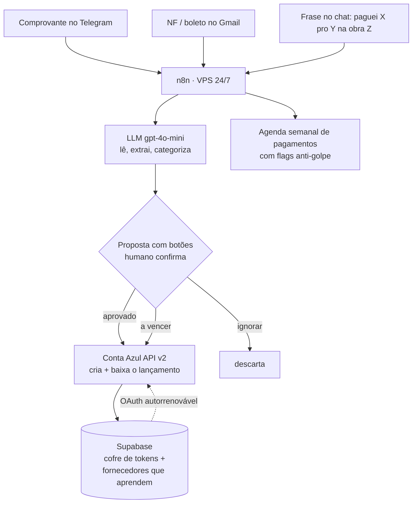

# Hermes — copiloto financeiro autônomo para uma PME industrial

> Diagnóstico → orquestração de IA → entrega end-to-end de um sistema que concilia,
> lança e projeta o caixa de uma indústria real, rodando 24/7 sem depender de máquina local.
>
> **De dono para dono:** apliquei IA primeiro na minha própria indústria antes de oferecer a alguém.

`n8n` · `LLM (gpt-4o-mini)` · `Conta Azul API v2` · `Supabase` · `Telegram` · `Gmail` · `OAuth`

---

## TL;DR — o resultado

Uma PME industrial (madeira estrutural, Simples Nacional) vivia uma crise de caixa recorrente
com a operação financeira **fragmentada e parada**: centenas de pendências de conciliação sem
tratar, recebíveis históricos que nunca deram baixa e dependência de um BPO externo caro.

Sem trocar o ERP e sem contratar um time de dev, orquestrei ferramentas que já existiam num
**copiloto financeiro autônomo** que:

- **automatiza a conciliação bancária** a partir de um comprovante mandado no chat;
- **lê nota fiscal e boleto do e-mail** e propõe o lançamento sozinho;
- **manda a agenda de pagamentos da semana** com alertas anti-golpe;
- roda **24/7 num VPS**, sem depender do computador de ninguém.

> ⚠️ *Os números agregados abaixo são da minha própria empresa. Revisar o que faz sentido
> expor publicamente antes de publicar (ver seção "Antes de publicar").*

| Antes | Depois |
|---|---|
| Centenas de pendências de conciliação acumuladas | Fluxo conciliado com confirmação humana em 1 toque |
| Recebíveis históricos sem baixa inflando o faturamento aparente | Base histórica regularizada em lote via API |
| Conciliação dependente de BPO externo (~R$2,4k/mês) | Operação interna assistida por IA, em teste para substituir o BPO |
| "App de bolso" com saldo fake | Caixa real, para-brisa e não retrovisor |

---

## 1. O diagnóstico (mapeamento — separar oportunidade real de ruído)

O reflexo comum seria "trocar de ERP" ou "comprar mais um SaaS". **Não era isso.**

O ERP (Conta Azul) já estava pago e tinha API. O Open Finance com o banco já estava ligado.
A ferramenta estava pronta — **o trabalho é que estava parado**: ninguém dava conta de conciliar
o volume manualmente, então as pendências se acumulavam e o caixa virava uma caixa-preta.

O problema real não era de software. Era de **braço**: uma tarefa repetitiva, de alto volume,
que só um humano fazia — e por isso não era feita. É exatamente o tipo de dor em que a IA entra
no braçal e o humano fica no julgamento.

## 2. A arquitetura da solução (orquestração técnica)

Nada aqui foi "criado do zero". Foram **ferramentas que já existem, conectadas** com critério:
o ERP entrou pela API, o LLM lê e categoriza, o n8n orquestra, o Supabase guarda os tokens e o
aprendizado, e o chat vira a interface (a pessoa não abre sistema nenhum — manda uma mensagem).

## 3. As três frentes em produção

**1. Conciliação conversacional.** O dono manda o comprovante no grupo do Telegram. O LLM lê o
PDF, identifica valor/fornecedor/data, e propõe o lançamento com três botões: ✅ cria e baixa no
ERP · 📥 lança a vencer · 🚫 ignora. Um toque resolve.

**2. Leitura de e-mail.** Nota fiscal ou boleto que cai numa label do Gmail é lido
automaticamente, os dados são extraídos e o lançamento é proposto — sem digitação.

**3. Agenda de caixa (para-brisa).** Toda segunda de manhã, o agente posta os pagamentos dos
próximos dias já categorizados, com alertas: 🔴 fornecedor novo (anti-golpe), ⚠️ valor divergente
do histórico, 🕳️ recorrente que deveria ter aparecido e não apareceu.

## 4. IA no braçal, humano no julgamento

| A IA faz | O humano decide |
|---|---|
| Lê comprovante/NF/boleto e extrai os campos | Aprova ou rejeita cada lançamento (1 toque) |
| Categoriza por histórico de fornecedores | Resolve casos ambíguos e exceções |
| Propõe a baixa no ERP | Confirma pagamentos a pessoas físicas (o sistema não vê CPF no extrato) |
| Sinaliza risco (golpe, divergência) | Dá a palavra final no que sai do caixa |

**Escrita sensível nunca é 100% autônoma:** todo lançamento que mexe em dinheiro passa por uma
confirmação humana. Autonomia com trava, não autonomia cega.

## 5. Decisões de engenharia que fizeram funcionar

- **Human-in-the-loop antes de autonomia total** — confiança se constrói por etapas; primeiro o
  agente *propõe*, o dono *aprova*, e só o que já é seguro vira automático.
- **Roda no VPS, não no meu Mac** — a operação não pode depender de um computador ligado. É
  infraestrutura, não script de mesa.
- **Token OAuth autorrenovável com cofre no Supabase** — o refresh rotaciona; salvar sempre o
  token retornado foi a diferença entre "quebra toda hora" e "roda sozinho".
- **Cadastro de fornecedores que aprende** — cada exceção resolvida vira conhecimento; da próxima
  vez o agente já sabe categorizar.
- **Anti-golpe embutido** — fornecedor novo e valor fora do padrão são sinalizados antes de pagar.

## 6. O mesmo motor, outro vertical

Este copiloto categoriza **custo real por obra** para uma indústria. O mesmo mecanismo
conversacional — mandar uma frase e receber um lançamento categorizado — se aplica direto ao
**investidor imobiliário**: *"recebi o aluguel do apto X", "paguei o condomínio do Y"* →
**retorno real por imóvel, sem planilha**. Do custo-por-obra ao retorno-por-imóvel é a mesma
arquitetura apontada para outra dor. *(É a base do produto Rentta.)*

## 7. Stack

Orquestração **n8n** (self-hosted, VPS) · IA **gpt-4o-mini** (leitura, extração, categorização) ·
**Conta Azul API v2** (leitura + escrita, OAuth) · **Supabase** (cofre de tokens + base de
aprendizado) · **Telegram Bot API** (interface + confirmação) · **Gmail API** (ingestão de
NF/boleto) · Python para os scripts de carga e regularização em lote.

---

## Antes de publicar (checklist de sanitização)

- [ ] Confirmar quais números agregados podem ser públicos (ou trocar por ordem de grandeza/%)
- [ ] Garantir zero dado real: sem CPF, sem nome de cliente/fornecedor, sem ID de conta, sem valor de fatura individual
- [ ] Decidir se nomeia a empresa (FLORESTi) ou mantém "PME industrial de madeira"
- [ ] Gerar 1 GIF/vídeo de 60s da conciliação acontecendo (a demo vale mais que o texto)

## Sobre

**ModestIAndré** — empresário-operador que aplica IA à operação, de dono para dono.
Engenheiro, dono de indústria. Não vendo software bonito: **diagnostico a dor real do negócio e
conecto a solução específica e construível** — e nem tudo precisa de IA.
